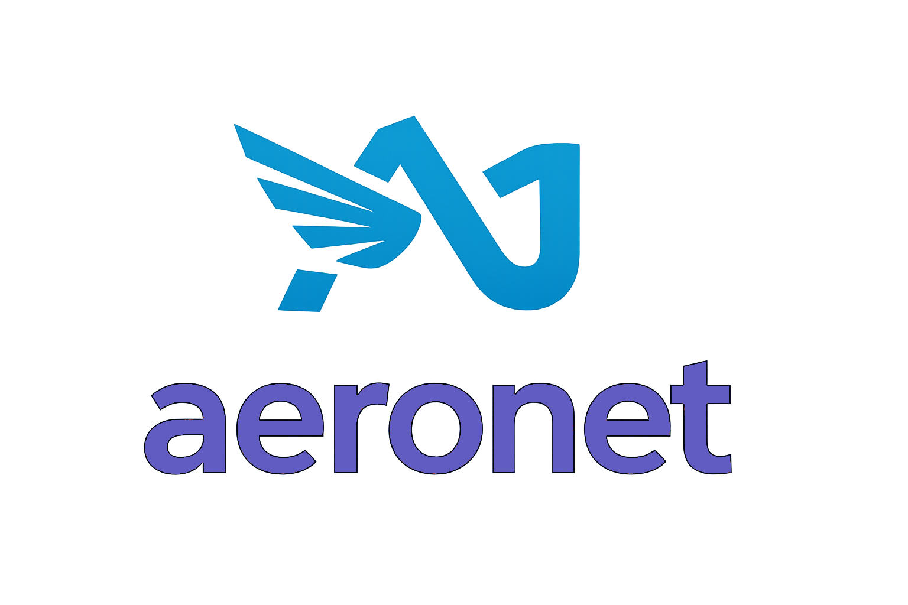

# aeronet

<p align="center">
  
</p>

<p align="center">
  <a href="https://sjanel.github.io/aeronet/"><strong>Documentation: sjanel.github.io/aeronet</strong></a>
</p>

[](https://github.com/sjanel/aeronet/actions/workflows/ci.yml)
[](https://codecov.io/gh/sjanel/aeronet)
[](https://github.com/sjanel/aeronet/actions/workflows/packaging.yml)
[](https://sjanel.github.io/aeronet/benchmarks/)
[](https://sjanel.github.io/aeronet/benchmarks/h2/benchmarks_h2c.html)
[](https://sjanel.github.io/aeronet/benchmarks/h2/benchmarks_h2-tls.html)
[](https://sjanel.github.io/aeronet/benchmarks/ws/)
[](https://sjanel.github.io/aeronet/benchmarks/clients/)
[](https://sjanel.github.io/aeronet/benchmarks/clients/client_benchmark_h2c.html)
[](https://sjanel.github.io/aeronet/benchmarks/clients/client_benchmark_h2-tls.html)
[](https://github.com/sjanel/aeronet/releases/latest)

## Why aeronet?

**aeronet** is a modern, fast, modular and ergonomic HTTP / WebSocket C++ **server & client** library for **Linux**, **macOS** and **Windows** focused on predictable performance, explicit control and minimal dependencies.

- **Fast & predictable**: edge‑triggered reactor model, zero/low‑allocation hot paths and minimal copies, horizontal scaling with port reuse. In CI benchmarks `aeronet` ranks among the [fastest tested implementations](#performance-at-a-glance) across multiple realistic scenarios.
- **Modular & opt‑in**: enable only the features you need at compile time to minimize binary size and dependencies
- **Ergonomic**: easy API, automatic features (encoding, telemetry), RAII listener setup with sync / async server lifetime control, developer friendly with no hidden global state, no macros
- **Configurable**: extensive dynamic configuration with reasonable defaults, per path options and middleware helpers, run-time router / config updates
- **Standards compliant**: HTTP/1.1, HTTP/2, WebSocket, Compression, Streaming, Trailers, TLS, CORS, Range & Conditional Requests, Static files, URL Decoding, multipart/form-data, etc.
- **Batteries included**: beyond the server, a matching HTTP **client** and a **JWT** (JWS) module for signing/verifying tokens - same opt‑in, zero‑extra‑dependency design (both reuse the server's own transport / TLS / crypto bricks).
- **Cloud native**: Built-in Kubernetes-style health probes, opentelemetry support (metrics, tracing) with built-in spans and metrics, dogstatsd support, perfect for micro-services
- **Cross‑platform**: primary platform is **Linux** (epoll); macOS (kqueue) and Windows (WSAPoll) are supported with a portable abstraction layer. Some Linux‑specific optimizations (kTLS, `MSG_ZEROCOPY`, `sendfile`) are automatically disabled on other platforms.

### Performance at a glance

`aeronet` is designed to be **very fast**, optimized for **Linux**. In our automated [wrk](https://github.com/wg/wrk)-based benchmarks (HTTP/1.1), [h2load](https://nghttp2.org/documentation/h2load-howto.html)-based benchmarks (HTTP/2), and [k6](https://k6.io/)-based benchmarks (WebSocket) against other popular frameworks (run in CI against a fixed set of competitors such as [drogon](https://github.com/drogonframework/drogon), [pistache](https://github.com/pistacheio/pistache), [Crow](https://github.com/CrowCpp/Crow), a [Rust Axum server](https://docs.rs/axum/latest/axum/), [Undertow in Java](https://github.com/undertow-io/undertow), Go and Python), `aeronet`:

- Achieves the **highest requests/sec** in most scenarios
- Consistently delivers **lower average latency** in those same scenarios
- Maintains **competitive or better throughput and memory usage**

You can inspect the latest benchmark tables generated on `main` from the CI **benchmarks** job and detailed methodology here:

- [Latest CI benchmarks (HTTP/1.1, HTTP/2, WebSocket)](https://github.com/sjanel/aeronet/actions/workflows/benchmarks-gh-pages.yml?query=branch%3Amain)
- [Benchmark scenarios and methodology](benchmarks/scripted-servers/README.md)

You can browse the latest rendered benchmark tables directly on GitHub Pages:

- [HTTP/1.1 Live benchmark dashboard](https://sjanel.github.io/aeronet/benchmarks/)
- [HTTP/2 clear-text Live benchmark dashboard](https://sjanel.github.io/aeronet/benchmarks/h2/benchmarks_h2c.html)
- [HTTP/2 TLS Live benchmark dashboard](https://sjanel.github.io/aeronet/benchmarks/h2/benchmarks_h2-tls.html)
- [WebSocket Live benchmark dashboard](https://sjanel.github.io/aeronet/benchmarks/ws/)
- [HTTP/1.1 client Live benchmark dashboard](https://sjanel.github.io/aeronet/benchmarks/clients/) (aeronet `HttpClient` vs libcurl / drogon / beast)
- [HTTP/2 clear-text client Live benchmark dashboard](https://sjanel.github.io/aeronet/benchmarks/clients/client_benchmark_h2c.html) (aeronet `HttpClient` vs libcurl, h2c)
- [HTTP/2 TLS client Live benchmark dashboard](https://sjanel.github.io/aeronet/benchmarks/clients/client_benchmark_h2-tls.html) (aeronet `HttpClient` vs libcurl, ALPN `h2`)

## Minimal Example

Spin up a basic HTTP server that responds on `/hello` in just a few lines.
**All code examples** in the `README` and the documentation pages are guaranteed to compile as they are covered by a CI check.

```cpp
#include <aeronet/aeronet.hpp> // unique 'umbrella' header, includes all public API

using namespace aeronet;

int main() {
  Router router;
  router.setPath(http::Method::GET, "/hello", [](const HttpRequestView& req) {
    return HttpResponse(200).header("x-req-body", req.body()).body("hello from aeronet\n");
  });
  HttpServer server(HttpServerConfig{}, std::move(router)); // default port is ephemeral, OS will pick an available one
  server.run(); // blocking. Use start() for non-blocking
}
```

See the [full program](examples/server-minimal.cpp).

Streaming responses, coroutine (async) handlers, routing, middleware and the rest are covered in the [documentation](https://sjanel.github.io/aeronet/): start with [Your first server](docs/getting-started/first-server.md), then [Routing](docs/guides/routing.md), [Streaming responses](docs/guides/streaming-responses.md) and [Async handlers](docs/guides/async-handlers.md).

## Quick Start with provided examples

Minimal server examples for typical use cases (multi-threaded server, TLS, HTTP/2, WebSocket, static files, sendfile, HTTP client, ...) are provided in the [examples](examples) directory.

```bash
cmake -S . -B build -DCMAKE_BUILD_TYPE=Release
cmake --build build

./build/examples/aeronet-server-minimal 8080   # or omit 8080 for ephemeral
```

Test with curl:

```bash
curl -i http://localhost:8080/hello

HTTP/1.1 200
date: Wed, 11 Feb 2026 22:46:04 GMT
content-type: text/plain
content-length: 151
server: aeronet

Hello from aeronet minimal server! You requested /hello
```

## Features

| Area | Highlights | Documentation |
| ---- | ---------- | ------------- |
| HTTP/1.1 server | Keep-alive, pipelining, chunked bodies, trailers, limits, streaming, duplicate header policy | [Servers and lifecycle](docs/guides/server-lifecycle.md), [conformance](docs/reference/http-conformance.md) |
| Routing & requests | Path parameters, wildcards, route groups, per-route options, query / forms / multipart | [Routing](docs/guides/routing.md), [Requests](docs/guides/requests.md), [Responses](docs/guides/responses.md) |
| Middleware | Global + per-route hooks, rate limiting (in-memory / Redis), CORS | [Middleware](docs/guides/middleware.md), [CORS](docs/guides/cors.md) |
| Compression | gzip / deflate / zstd / brotli, outbound negotiation and inbound decompression | [Compression](docs/guides/compression.md) |
| Static files | `sendfile`, range and conditional requests | [Static files](docs/guides/static-files.md) |
| Async handlers | Coroutines (`RequestTask`), background work off the event loop | [Async handlers](docs/guides/async-handlers.md) |
| TLS (flag) | ALPN, mTLS, SNI, tickets, OCSP stapling, CRLs, kTLS, HTTP to HTTPS redirect | [TLS](docs/protocols/tls.md) |
| HTTP/2 (flag) | RFC 9113, HPACK, ALPN h2, h2c, multiplexing | [HTTP/2](docs/protocols/http2.md) |
| WebSocket (flag) | RFC 6455, permessage-deflate, ping/pong, close handshake | [WebSocket](docs/protocols/websocket.md) |
| HTTP client (flag) | HTTP/1.1 + HTTP/2, keep-alive pool, redirects, proxy, streamed bodies, auto (de)compression | [HTTP client](docs/modules/http-client.md) |
| JWT (flag) | RFC 7519 JWS sign / verify, JWK / JWKS, rejects `alg:none` | [JWT](docs/modules/jwt.md) |
| Observability | OpenTelemetry (experimental), DogStatsD, logging, metrics callback | [Observability](docs/operations/observability.md) |
| Operations | Kubernetes-style probes, graceful drain, signal handling, runtime config / router updates, JSON / YAML configuration | [Health probes](docs/operations/health-probes.md), [Kubernetes examples](docs/operations/kubernetes.md), [JSON and config files](docs/modules/json-and-config-files.md) |
| Performance | Edge-triggered reactor, `SO_REUSEPORT` scaling, `writev`, `MSG_ZEROCOPY` | [Performance and tuning](docs/operations/performance.md) |

The complete list is in the [feature overview](docs/getting-started/overview.md#feature-overview). Every feature marked *flag* is opt-in at compile time, see the [build configuration reference](docs/reference/configuration.md). Runtime options are listed in the [server](docs/reference/server-configuration.md) and [client](docs/reference/client-configuration.md) configuration references.

## Platform Support

| Platform | Status | I/O backend |
| -------- | ------ | ----------- |
| **Linux** (x86_64, aarch64) | Full support (primary; tested on Ubuntu and Alpine in CI) | epoll (edge-triggered) |
| **macOS** (Apple Silicon / x86_64) | Supported | kqueue |
| **Windows** (x64, MSVC) | Supported | WSAPoll |

Linux-specific optimizations (kTLS, `sendfile`, `MSG_ZEROCOPY`, `eventfd` / `timerfd`, DogStatsD over Unix sockets) are automatically disabled on other platforms.

## Build & Installation

Full build, install, package manager (Conan, vcpkg), `find_package` / FetchContent and C++ modules instructions live in [docs/getting-started/install.md](docs/getting-started/install.md).

## Documentation

The full documentation, with search and navigation, is at [sjanel.github.io/aeronet](https://sjanel.github.io/aeronet/); its sources are in [docs](docs/index.md). See also the [changelog](docs/CHANGELOG.md) and the [roadmap](docs/ROADMAP.md).

## Acknowledgements

Compression libraries (zlib, zlib-ng, zstd, brotli), OpenSSL, Opentelemetry and spdlog provide the optional feature foundation; thanks to their maintainers & contributors.

This project also includes code from the following open source projects:

- [amc](https://github.com/amadeusitgroup/amc), licensed under the MIT License.
- [flat_hash_map](https://github.com/skarupke/flat_hash_map), no license.
- [CityHash](https://github.com/google/cityhash), licensed under the MIT License.

## License

Licensed under the MIT License. See [LICENSE](LICENSE).
